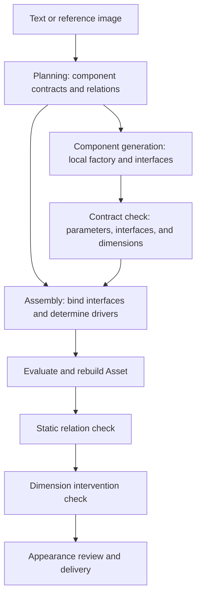

# Relation-Preserving Component Generation and Assembly: Design Draft

Date: 2026-10-17. Status: discussion draft; the new types, interfaces, and flows below are not yet implemented. This document proposes an incremental scheme based on the existing `Asset`, `RelationAssembly`, the bookshelf example, and the Agent workflow.

## Core Decisions

The deliverable of component generation should include a **rebuildable recipe, semantic interfaces, permitted changes, and conditions that must be preserved**. Assembly establishes persistent relations through these interfaces, solves for dimensions and poses, and then generates geometry. In the end both the editable definition and a geometry snapshot are saved.

For example, "the bookshelf has a book in it" only states ownership; "the bottom of the book is supported by the second-tier shelf board" is what states how the book should move after the shelf board changes. Physical common sense helps propose candidate relations, but the design intent finally adopted must be explicitly recorded.

This does not mean handing all relations to a general physics solver from the start. The first stage keeps the current deterministic forward rebuild and first completes the component contract and the assembly definition.

## Foundations and Gaps in the Existing Code

| Current entry point | Existing capability | Needs to be added |
|---|---|---|
| `adsl-agents/models.py`: `ObjectComponent` | Name and description | Stable ID, parameters, interfaces, mutability, check conditions |
| `ObjectPlan.relations` in the same file | `list[str]` textual relations | Parseable relation types, endpoint references, parameters, and evidence sources |
| `adsl-core/core/asset.py`: `attach_part` | Geometric ownership and semantic hierarchy | Assembly relations beyond ownership should be saved in a separate definition |
| `adsl-core/core/relations.py` | Parameters/datum planes, span, support, attachment, containment; rebuild at compile time | Component factories, local interfaces, interface binding, structured failure reports, and replayable definitions |
| `examples/physical_bookshelf/model.py` | Explicit vertical dependency chain, books as rigid sub-assemblies | Still mixed with world coordinates; width, depth, and repeated modules are not yet uniformly parameterized |
| `adsl-agents/service.py` | Execute, render, and review loop | Image approval can terminate directly; independent relation-verification and modification-verification gates are needed |
| `adsl-core/core/serialize.py` | Geometry and joint snapshots | Complete component/assembly definitions need to be saved separately and linked to snapshots |

The current relation report only gives a literal summary of shapes and cannot be replayed directly; the source program should be kept as the basis for rebuilding until versioned recipe serialization is available.

## 1. Component Contract: What to Generate, and Also Declare How to Use It

It is recommended to wrap the geometry factory in a new `ComponentDefinition`, instantiate it as `ComponentInstance`, and after solving produce an ordinary `Asset`. These are proposed types, not currently callable APIs.

| Content | Meaning | Bookshelf example |
|---|---|---|
| Identity and responsibility | Type ID, instance ID, version, function | `board/shelf`; `shelf_2`; supports items |
| Parameters | Units, defaults, valid ranges, who may drive them | Board width is driven by the cabinet's clear width; board thickness is independently fixed |
| Local geometry factory | Rebuild internal parts after parameters change | Rebuild the board when its width changes, with the fillet radius kept at the specified value |
| Interfaces `ports` | Named points, coordinate frames, faces, axes, or bounded regions | A shelf board's `support_surface`; a book's `base_contact` |
| Change policy | Editable parameters, allowed pose degrees of freedom, shape-preservation conditions | A book may translate/rotate when assembled, with its size kept; side panels are allowed to rebuild their span |
| Pre- and postconditions | What the input must satisfy; what is guaranteed after generation | Dimensions positive and finite, interfaces exist, board thickness equals the specified value |
| Evidence source | User-specified, component-library specification, or inferred assumption | "Books keep their size" is a default functional assumption and can be overridden by the user |

"Rigid" describes behavior when the assembly is modified; it does not mean such components can never change size. If the user explicitly asks to swap in a larger book, its generation parameters can be changed; when only the cabinet is modified, the assembler may not on its own scale the book to remove a conflict.

Interfaces must live in the component's own local coordinate system and be recomputed as component parameters change; a stale copy of world coordinates must not be stored. Named semantic interfaces are more stable than binding directly to mutable mesh face indices. The current `Asset`'s ordinary child nodes have no independent transform matrix, so the instance pose that maps local interfaces to world interfaces must be managed by the new definition layer; it cannot be assumed that the existing Asset already supports it.

A support interface must contain at least a bounded region and a normal, not merely a vertex or the highest point of an AABB. The first version may state explicitly that it supports only axis-aligned rectangles; rotated surfaces, leaning, and curved surfaces are marked unsupported, to avoid giving wrong guarantees.

## 2. Assembly Contract: Bind Interfaces, and Determine What May Change

The same component can serve different purposes in different assemblies; a book must not hard-code "second tier" in its own definition. It is the assembly instance that establishes `book_17.base_contact -> shelf_2.support_surface`.

Each relation should contain: a stable relation ID, type, instance/interface references, unit-consistent parameters, driving direction or solving strategy, a checker, and a source. Soft preferences also need explicit priorities; the first version may implement only hard relations.

Three kinds of roles must be distinguished:

1. **Construction rule**: compute output from input, e.g. the clear width determines the shelf-board width.
2. **Feasibility condition**: verify a result, e.g. a book must lie inside a cabinet cell; it does not by itself authorize modifying the book or the cell.
3. **Soft preference**: choose among multiple legal solutions, e.g. books as far left as possible, spacing as even as possible.

An interface-coincidence relation usually cannot eliminate all degrees of freedom. For example, "a book rests on a horizontal shelf board" determines only the height and part of the orientation; X/Y and the rotation about the vertical axis must still be determined by a layout policy. An arbitrary default must not be treated as the result of physical derivation.

| Proposed relation | What it drives | Preservation conditions |
|---|---|---|
| `supported_by` | Rigid-body pose driven by the support surface and layout | Own dimensions unchanged; geometric contact/projection rules satisfied |
| `spans_between` | Specified generation parameters change with two boundaries | Thickness and unauthorized parameters preserved |
| `mounted_on` | Mounting pose changes with the target interface | Component's internal shape preserved |
| `fits_within` | Check containment/clearance | Fail on conflict; do not implicitly scale or delete contents |
| `parameter_binding` | A component parameter is driven by an external parameter/interface distance | A single explicit driver, units match |

These are design vocabulary; when landing them, compile to the existing `supported`, `attached`, `span_box`, and `within` as far as possible. The current `supported` keeps only X/Y and places along Z, and `attached` only translates based on AABB anchors; they do not support all the generalized semantics in the table above.

## 3. Three Structures Recorded Separately

- The **ownership tree** answers "who manages it": the spine text belongs to the book, and the book belongs to the scene or a semantic cabinet cell.
- The **relation graph** answers "which satisfies what condition with which": a book is supported on a shelf board, may also support another stack of books, and has a containment relation with the cabinet cell.
- The **evaluation dependency graph** answers "who is computed first": cabinet parameters -> shelf-board pose -> book pose -> spine details.

They are not the same graph. The relation graph may have cycles, e.g. four boards enclosing a frame; the forward evaluation graph must have a clear direction and no cycles. In the first version, a cycle that requires simultaneous solving should be explicitly rejected or have its degrees of freedom removed through extra datums; not all cycles should be judged as physical relation errors.

Cross-component relations bind only external interfaces. A component's internal subdivided primitives, chamfers, or patterns can be replaced; as long as the external contract is maintained, other components need not access private geometry.

## 4. Concrete Bookshelf Decomposition and Propagation

Recommended components: base, left and right side panels, back panel, shelf-board module, top decoration, and books. A cabinet cell exists as a semantic space / layout domain and does not necessarily need its own solid mesh; it provides boundaries and usable space.

Let `z_i` be the top surface of the i-th shelf board, `h_i` the clear height of the cabinet cell above it, and `t_i` the thickness of the shelf board. Then:

```text
z_1 = bottom datum
z_(i+1) = z_i + h_i + t_(i+1)       (i = 1, 2, 3)
crown_seat = z_4 + h_4
total height = crown_seat + crown decoration height
```

In this pattern the clear height is the driving parameter and the total height is a derived quantity. The total height and all clear heights cannot both be freely driven: if the user requires the total height to stay unchanged, one must first choose how the clear heights are redistributed, or report a conflict with "increase every tier."

When all `h_i += 0.1 m`:

| Object | Expected change |
|---|---|
| Shelf boards of tier 1/2/3/4 | Move up by 0 / 0.1 / 0.2 / 0.3 m respectively |
| Top | Moves up 0.4 m |
| Side panels, back panel | Vertical span increases by 0.4 m, thickness preserved |
| Books of tier 1/2/3/4 | Move up by 0 / 0.1 / 0.2 / 0.3 m respectively, size preserved |
| Stacked books | Move along the real support chain; not all books may be bound only to the semantic parent group |
| Spine text, covers | Move with the book as internal details of the book component |

In the reverse case, when the cabinet cell is shrunk until the contents no longer fit, the default result is an explicit failure. Changing the layout, moving to another tier, swapping books, and raising the cabinet cell are all new strategy choices that require an explicitly authorized edit policy; the solver must not choose them silently.

The same structure can be used for a sofa chair: seat width drives the cushion factory and the cross-rail span, and the armrests and rear legs are bound to mounting interfaces. Whether stud/pattern selection keeps the size and redistributes, or keeps the count, must be a strategy explicitly chosen by the component; real-world common sense does not uniquely determine this.

## 5. A Flow Shared by Generation and Assembly



1. **Planner** outputs structured parameters, components, interfaces, and relations; the source of inferred content is retained. Relations beyond the solver's capability are flagged in the planning stage.
2. **Component generator** generates a local factory according to the external contract. If an interface does not meet requirements, a component-level failure is returned, and it must not be masked with a world-coordinate patch.
3. **Assembler** binds interfaces, checks for missing references, multiple drivers, degrees of freedom, and unsolvable dependencies, and then evaluates to generate geometry.
4. **Verifiers** separately verify the contract, static geometric relations, and actual editing behavior. Self-declarations based on construction rules are not enough; checkers should read the result geometry or interfaces as far as possible and verify invariants.
5. **Repair** receives structured failures: relation ID, related components, parameters, expected/actual values, check scope, and source, and modifies the contracts/rules that control it. On failure the last valid model is kept, and candidate results do not overwrite the deliverable.

The existing Coder can take on component and assembly code generation; there is no need to first split execution into multiple models or multiple Agents. The key first step is a unified representation and checkable results.

## 6. Persistence and Verification

Component definitions, instance parameters, relations, and edit policies are the editable source, and Asset/GLB are the corresponding snapshots. Initially, continue to save the source `.py` and reports; later serialization should include the schema version, component type/version, instance ID, parameters, interface references, relations, geometry-factory references or complete rebuildable code, and the version/fingerprint corresponding to the snapshot.

Properties must not simply be added ad hoc to `Asset`: the existing serialization does not save these properties. Nor can the current `relations.json`, which does not contain complete shape recipes, be called a replayable assembly file.

Approvals must be recorded separately: appearance passed, geometric relations passed, editing behavior passed. Completion can be claimed only when all checks required by the request pass; unsupported or unexecuted checks are recorded as `unsupported` / `not_run` and must not be treated as passed. Reaching the round limit should also not produce a conclusion that relation verification succeeded.

The first round of modification uses the existing four-tier bookshelf as the contract-verification case:

- Default values reproduce the original geometry; each book instance and its ownership are stably retained.
- Raise all four tiers at once, and raise only the middle tier: check the propagation table and the preservation of board thickness / book size.
- Adjust width: the board is rebuilt and end interfaces updated; books do not deform; layout obeys an explicit policy. This is currently not uniformly supported.
- Shrink until contents no longer fit: give the conflicting relation ID and dimension evidence; keep the original model.
- Restore the original parameters after consecutive modifications: geometry and interfaces return to the original state, with no accumulated displacement error.
- Reload the source definition and recompile: relations can be recovered, rather than only obtaining a snapshot with the same appearance.

Current AABB checks support only limited geometric conclusions; their results are not elevated into proof of friction, center of gravity, load bearing, mesh collision-freeness, or stability.

## 7. Incremental Implementation Order

1. **Make the plan representation end-to-end**: add component contracts, structured relations, and modification probes to `ObjectPlan`; keep the old text fields for migration, and state explicitly that old models are not yet verified.
2. **Component-definition wrapper layer**: on top of `RelationAssembly`, add component factories and named interfaces, first supporting three kinds: axis-aligned boards, rigid books, and mounted decorations; keep the ordinary `Asset` as the geometric product.
3. **Bookshelf migration and intervention checks**: first get one example working end-to-end, verifying interfaces, drivers, and rejection of conflicts; add an independent pass gate to the workflow.
4. **Extend relations and solving capability**: then, based on explicit needs, add orientation, arbitrary-direction span, layout, cyclic constraints, and physical solving; state the verification scope each time.

This round's output is a design draft; the Agent schema, runtime, prompts, and existing models were not modified. The next implementation should target the minimal complete path of "components carry contracts + assembly preserves relations + modifications can be checked afterward."
